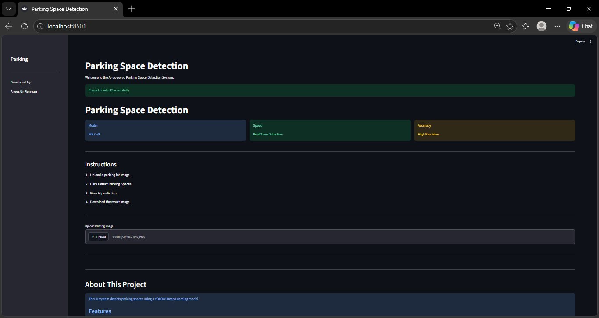
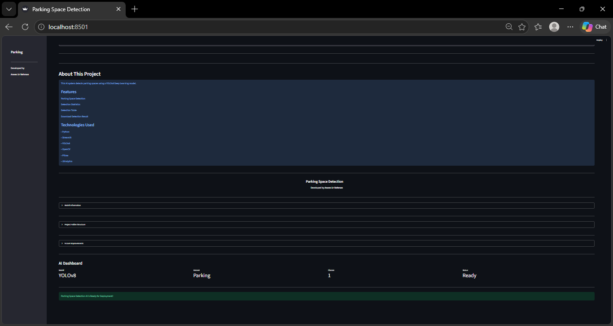

# Parking Space Detection AI

## Description
Parking Space Detection AI detects vacant and occupied parking spaces from parking lot images using a YOLOv8 object detection model. It helps drivers and parking lot managers monitor parking availability in real time.

## Live Demo
https://share.streamlit.io/aneesofficial/parking-space-detection-ai

## Tech Stack
* Python
* Streamlit
* YOLOv8 (Ultralytics)
* OpenCV
* Pillow
* NumPy
* Pandas

## Getting Started

### 1. Clone the repository
```bash
git clone https://github.com/aneesofficial/Parking-Space-Detection-AI.git
cd "Parking Space Detection AI"
```

### 2. Install dependencies
```bash
pip install -r requirements.txt
```

### 3. Run the application
```bash
streamlit run app.py
```

## Environment Variables
This project does not require any environment variables or .env file to run.

## Screenshots




